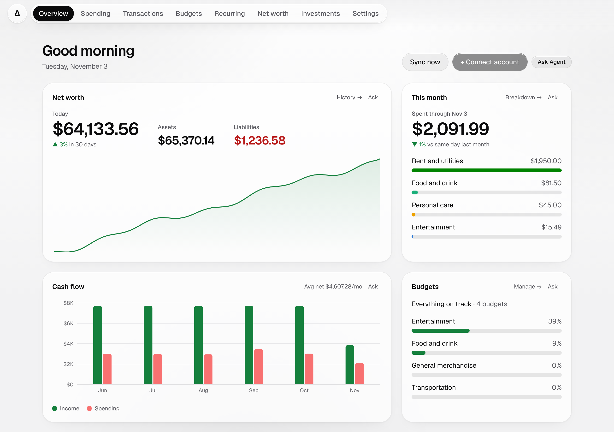

# Delta

[](https://github.com/zeapsu/Delta/actions/workflows/ci.yml)
[](LICENSE)
[](https://github.com/zeapsu/Delta/pkgs/container/delta)
[](https://zeapsu.github.io/Delta/)

A self-hosted personal finance dashboard your own agent can talk to.

<picture>
  <source media="(prefers-color-scheme: dark)" srcset="docs/img/overview-dark.png">
  
</picture>

Delta syncs your banks, cards and brokerage through [Plaid](https://plaid.com) into a SQLite file on your own machine, and shows spending, budgets, recurring charges, investments and net worth. No built-in chatbot: its [MCP](https://modelcontextprotocol.io) server gives the agent you already use the same numbers the dashboard shows.

**Docs:** [zeapsu.github.io/Delta](https://zeapsu.github.io/Delta/)

## Features

- **Overview:** net worth, spending so far, cash flow, connection health
- **Spending** by category, pending charges included
- **Transactions:** search, relabel one or a whole merchant
- **Budgets** per category
- **Recurring:** Delta spots subscriptions, you confirm them
- **Investments** and **net worth** history
- **Settings:** how closely your agent watches spending
- **MCP server and REST API** with read or write tokens
- **Ask** on every card copies it as a prompt
- Runs anywhere Docker does, including a Raspberry Pi

## Security model

**Optional password.** Your private network is the boundary ([Tailscale](https://tailscale.com) recommended). The API only answers allowed networks, agents need a revocable token, and Plaid access tokens never leave the database. Settings → Password adds a login. Never expose Delta to the internet. [Details](docs/self-hosting.md#security-model-read-this-first).

## Quick start

You need [Docker](docs/self-hosting.md#1-install-docker) (no account) and Plaid keys ([free for personal use](docs/plaid-trial.md)). Tailscale is optional, for using Delta from your phone.

**Home server app** (Portainer, CasaOS, Dockge, Synology, Unraid, TrueNAS): paste [`home-server/compose.yaml`](home-server/compose.yaml), open port 3000, add your Plaid keys in the browser. [Guide](docs/home-server.md).

**Terminal:**

```bash
curl -fsSL https://raw.githubusercontent.com/zeapsu/Delta/main/delta.sh | bash -s install
```

It clones into `./delta`, asks for Plaid keys (Enter skips to the browser), starts Delta and opens it. On a Mac it starts on that computer only; `./delta.sh phone` adds your phone over Tailscale. Later: `./delta.sh update` or `./delta.sh uninstall`.

Or by hand, instead of the script:

```bash
git clone https://github.com/zeapsu/Delta.git delta
cd delta
cp .env.example .env      # add Plaid keys here or on the setup page; see the Docker notes in .env
docker compose up -d --build
```

Open `DELTA_URL` and click **Connect account** (sandbox login: `user_good` / `pass_good`). On Linux with Tailscale, turn on [host networking](docs/self-hosting.md#linux-with-tailscale-use-host-networking) first. More: [self-hosting](docs/self-hosting.md), [update](docs/updating.md), [uninstall](docs/uninstalling.md).

## Connect an agent

In Delta, open **Settings → Agents**, create a token, and paste the config it shows into your agent (Claude Code, JSON for most MCP clients, or a stdio bridge). From a terminal: `docker compose exec delta npm run token -- create my-agent`. See [Connect an agent](docs/agents.md) and the [MCP tools](docs/mcp-tools.md).

## Development

```bash
npm ci
cp .env.example .env   # sandbox keys
npm run dev            # http://localhost:3000
npm test               # pure-logic self-checks
npm run lint
```

See [CONTRIBUTING.md](CONTRIBUTING.md) for the dev setup and conventions, and [docs/architecture.md](docs/architecture.md) for how it fits together. The doc site lives in `website/` (Docusaurus) and builds from `docs/`.

## License

Delta is free software under the [GNU Affero General Public License v3.0](LICENSE.md). You can run, change and share it; if you run a modified version as a service for other people, you have to offer them its source.
